<p align="center">
  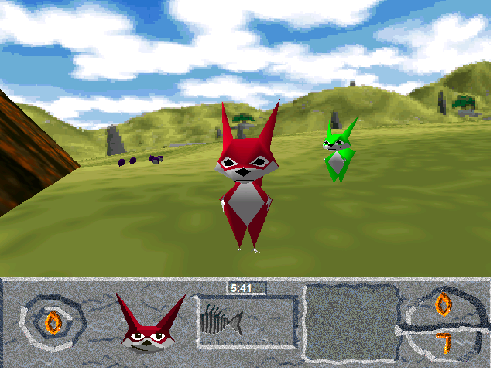
</p>

# Squeezils Revived: Hold On to Your Depth Buffer

A modern Windows 10/11 compatibility patch.

**Squeezils** is an unfinished
3D platform game developed by **(Proto)zoa** for Inscape. Its 1996 demos survived
despite the full game's cancellation.
[Some game history in detail](https://www.mobygames.com/game/235558/squeezils/)

A demo appeared on Microsoft's **Games Sampler 2 for Windows 95** in 1996, listed
as **(Hold Onto Your) Nuts!**
[Sampler contents](https://www.mobygames.com/game/71345/games-sampler-2-for-windows-95/)

## Our patch

The patch forwards the game's DirectDraw and Direct3D Retained Mode calls through
our own DLL layer. SDL3 provides a resizable window, with aspect-correct scaling,
aligned mouse input and fixes for HUD text.

Game supports internal rendering via SDL3 GPU or native D3D2 and Retained Mode paths.

## Screenshots

<table>
  <tr>
    <td align="center"><a href="screenshots/Squeezils-20261023-100044-238-19092-1.png">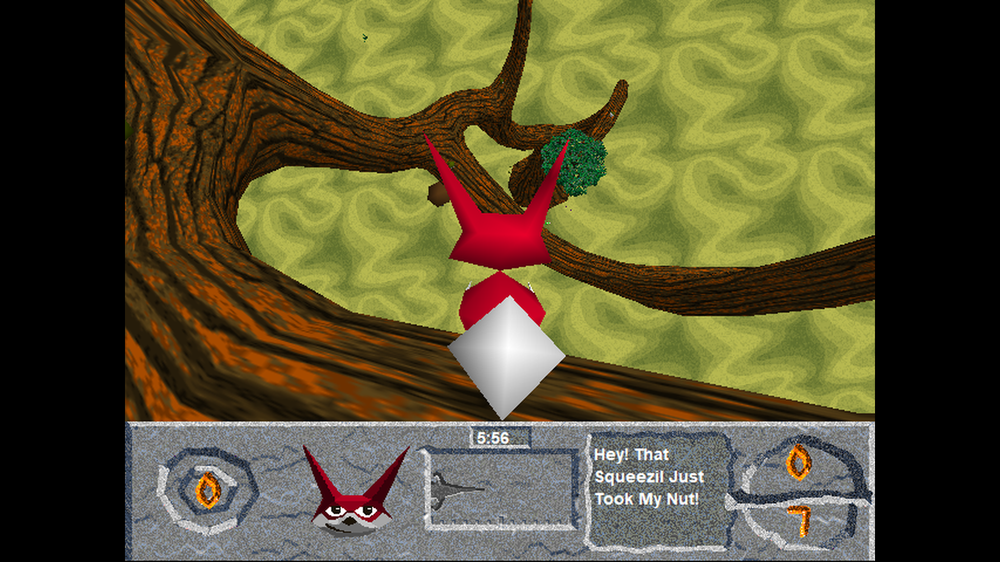</a></td>
    <td align="center"><a href="screenshots/Squeezils-20261023-100057-494-19092-2.png">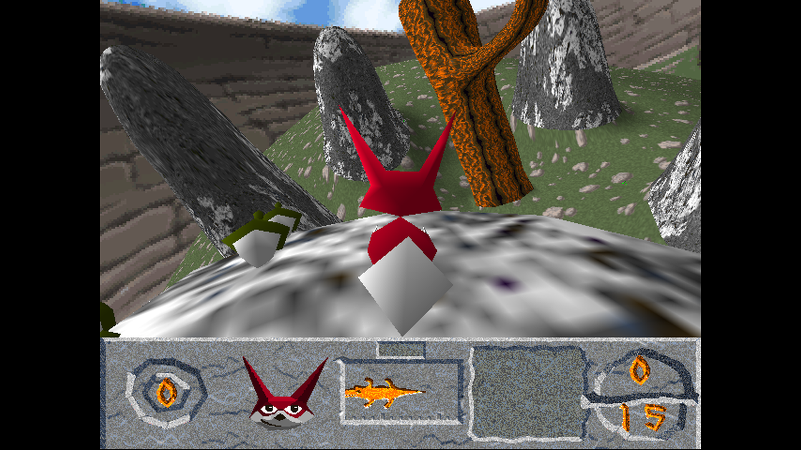</a></td>
    <td align="center"><a href="screenshots/Squeezils-20261023-100220-199-19092-3.png">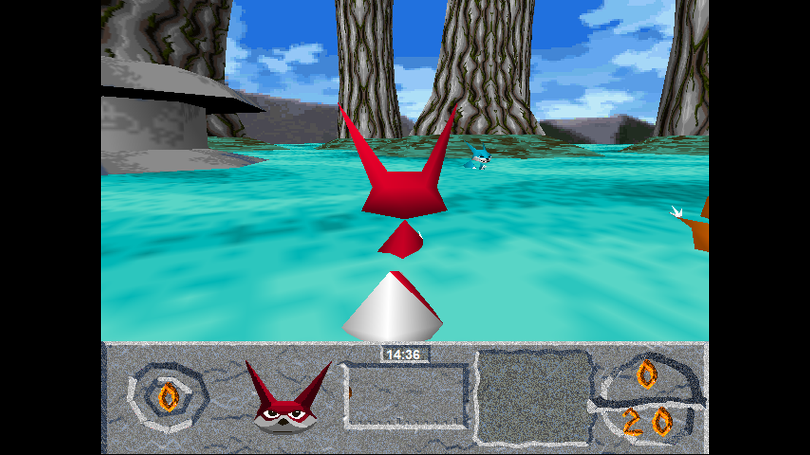</a></td>
  </tr>
  <tr>
    <td align="center"><a href="screenshots/Squeezils-20261023-100229-214-19092-4.png">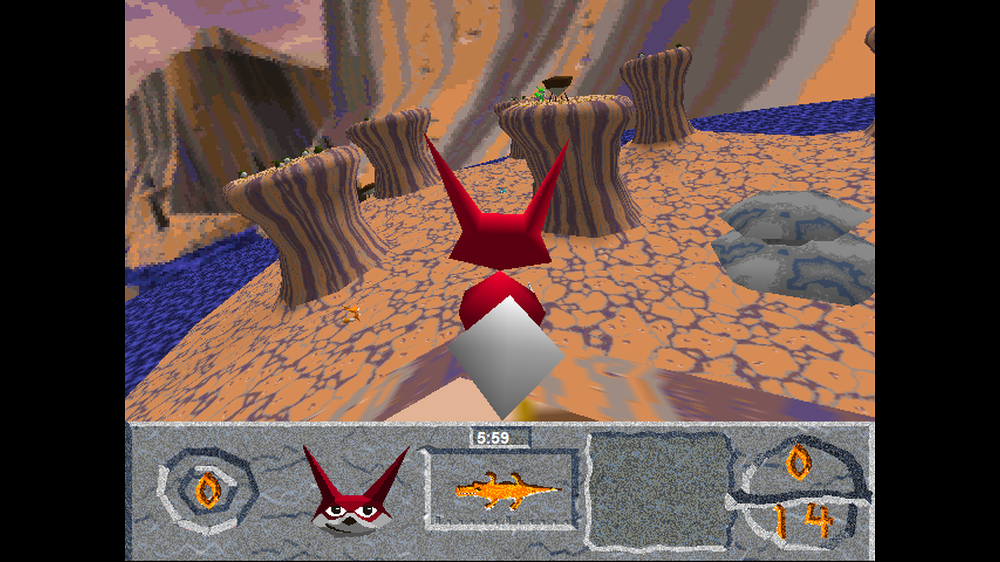</a></td>
    <td align="center"><a href="screenshots/Squeezils-20261023-100245-509-19092-5.png">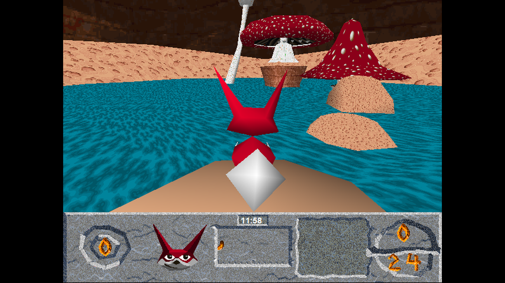</a></td>
    <td align="center"><a href="screenshots/Squeezils-20261023-100436-566-19092-6.png">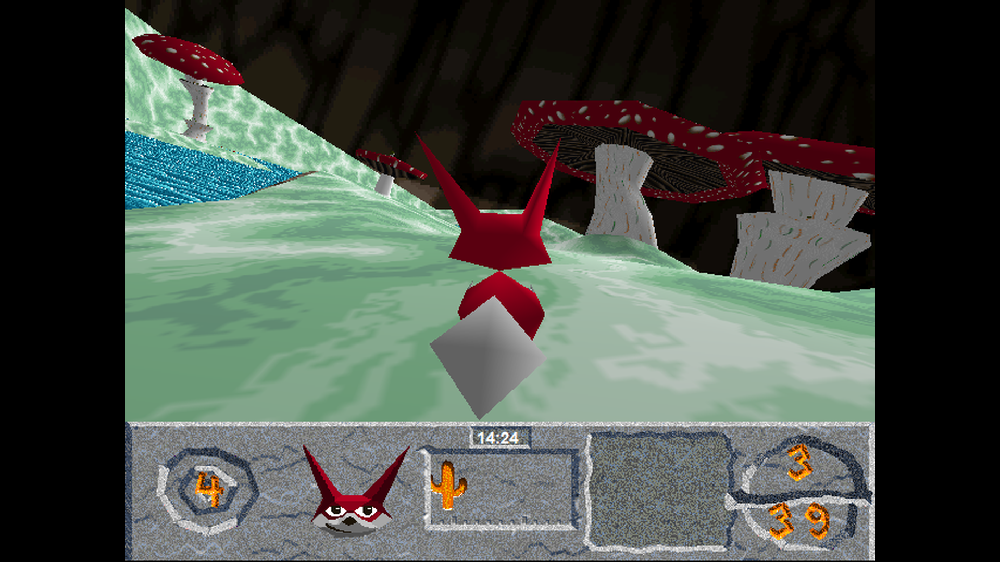</a></td>
  </tr>
  <tr>
    <td align="center"><a href="screenshots/Squeezils-20261023-100505-636-19092-7.png">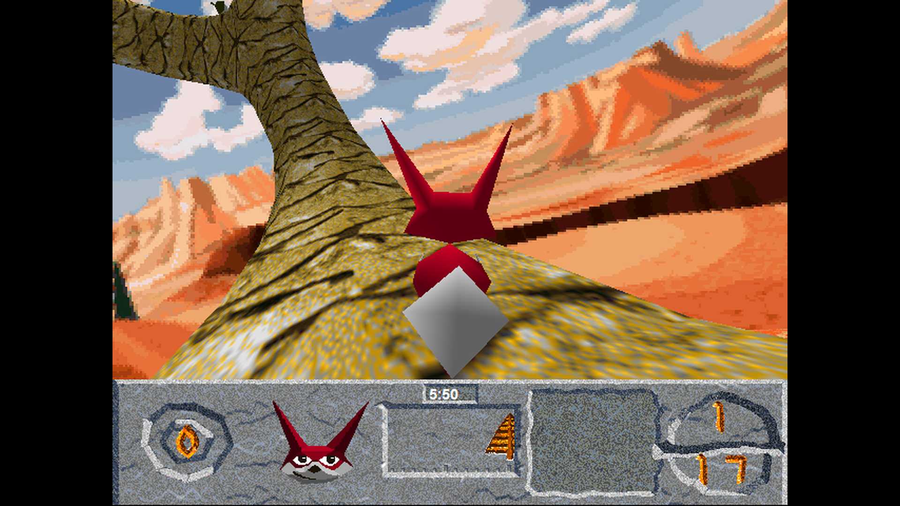</a></td>
    <td align="center"><a href="screenshots/Squeezils-20261023-100515-363-19092-8.png">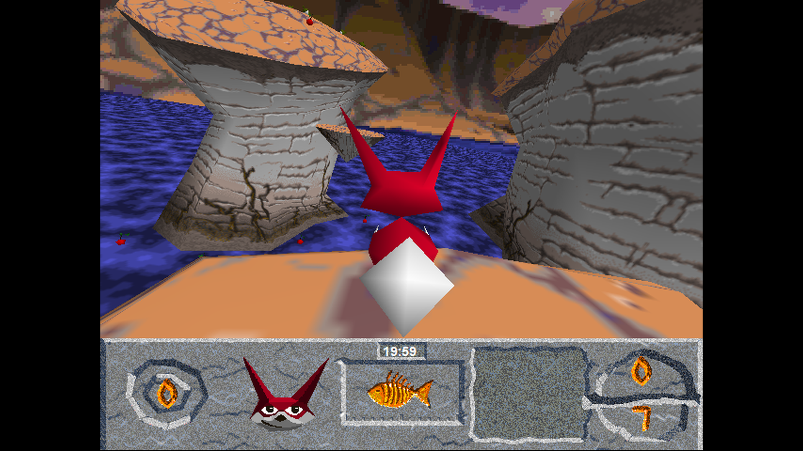</a></td>
    <td align="center"><a href="screenshots/Squeezils-20261023-100526-861-19092-9.png">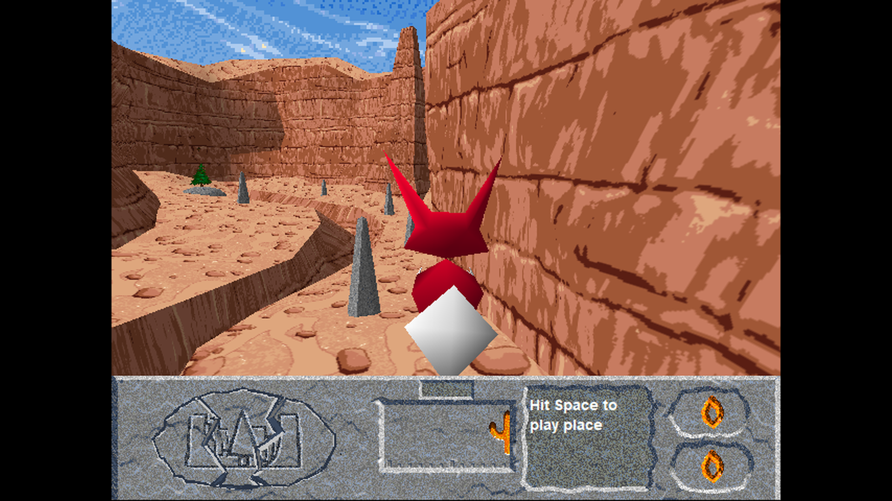</a></td>
  </tr>
  <tr>
    <td align="center"><a href="screenshots/Squeezils-20261023-100551-685-19092-10.png">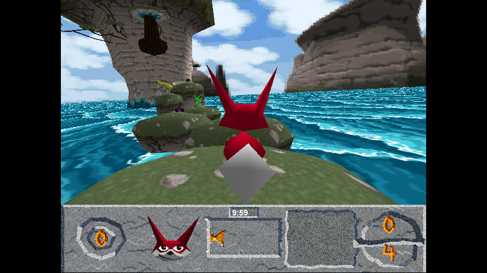</a></td>
    <td align="center"><a href="screenshots/Squeezils-20261023-100603-050-19092-11.png">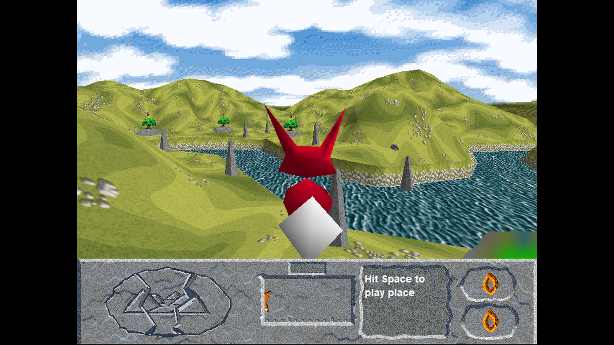</a></td>
    <td align="center"><a href="screenshots/Squeezils-20261023-100608-438-19092-12.png">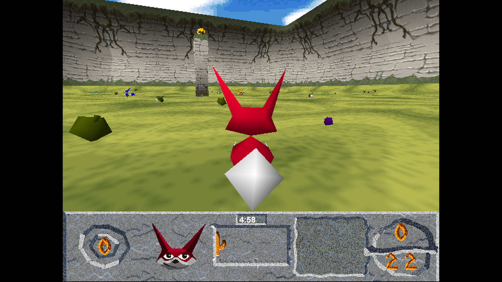</a></td>
  </tr>
</table>

## Installation

**Bring your own game files.** This project does not distribute the original
executable or assets. Keep a backup of your installation.

The currently tested executable is **`SQZ.EXE`**, from the updated v0.42b demo,
with this SHA-256:

```text
801931afc6ca09fdfffafb9c2f7223b2417b5c3895f57005091a817f3ec15194
```

Other executable versions have not been validated. Check your copy in PowerShell:

```powershell
Get-FileHash .\SQZ.EXE -Algorithm SHA256
```

1. Extract `squeezils-patch.zip` beside `SQZ.EXE`, replacing the existing
   `ddraw.dll` if present.
2. Run `SQZ.EXE`. SDL window support is enabled by default.

## Building

Requires **Windows**, **Python 3.9+**, and **32-bit MinGW-w64 GCC** with DirectX
headers. Add the compiler's `bin` directory to `PATH`; `gcc -dumpmachine` must
report `i686-w64-mingw32`.

Put the game's native `d3drm.dll` in `../SqueezilsGameFiles/`, then run from the
repository root:

```powershell
python tools/build.py
```

The build downloads and verifies pinned SDL3 dependencies automatically. The
ready-to-install ZIP is **`build/forward/squeezils-patch.zip`**; unpacked patch
files are in `build/forward/patch/`.

For tests or a playable local copy, also place
`Squeezils_Win_EN_v042b_updated.zip` in the same input directory:

```powershell
python tools/test.py           # Run tests; staging is not required
python tools/build.py --stage  # Also prepare build/forward/game/
```

Tests can alternatively read an extracted `SQZ.EXE` and `SQZ/GOODIES/` from the
input directory. Both scripts accept `--game-files "C:\path\to\game-files"`
to use a different location. Staging keeps existing game files and saves while
updating the patch DLLs.

## Control mappings

The controls dialog saves remaps to `input.cfg` beside `SQZ.EXE`.
With no valid local mapping, the game uses defaults from `SQZ/SQZ.INI`.

## Future work

- Explore possiblity of interpolating animation morps and having higher framerates.
- Package a simpler installation and launcher

## Testing saves

`test-saves/SAVE/` contains 38 level-entrance saves.
Copy its files into the game's `SQZ/SAVE/` directory, or run
`python tools/generate_test_saves.py --install` after staging a game installation.
